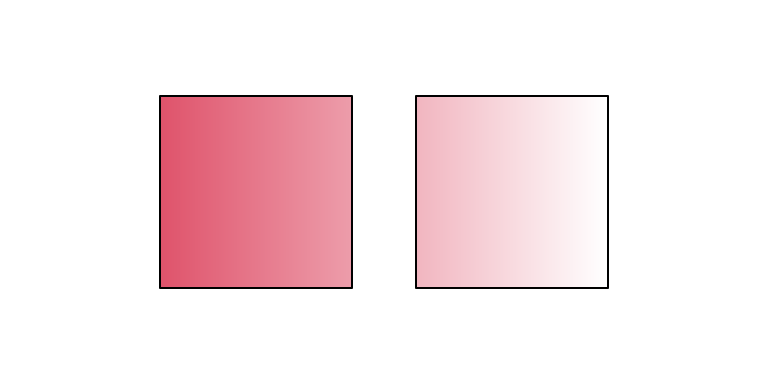
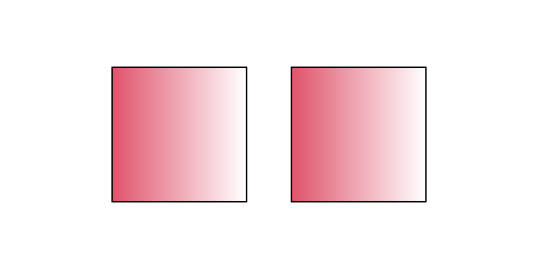
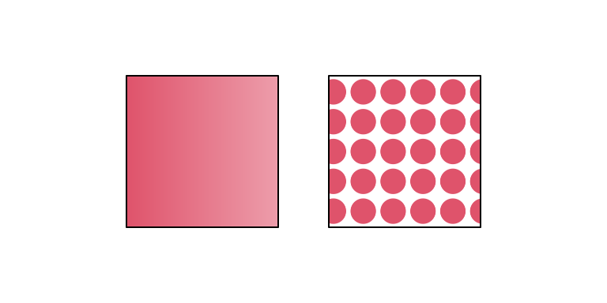
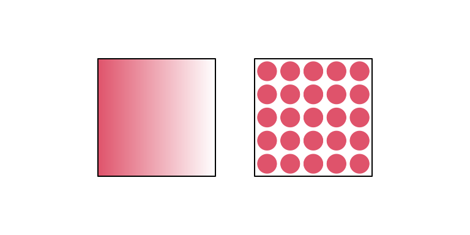
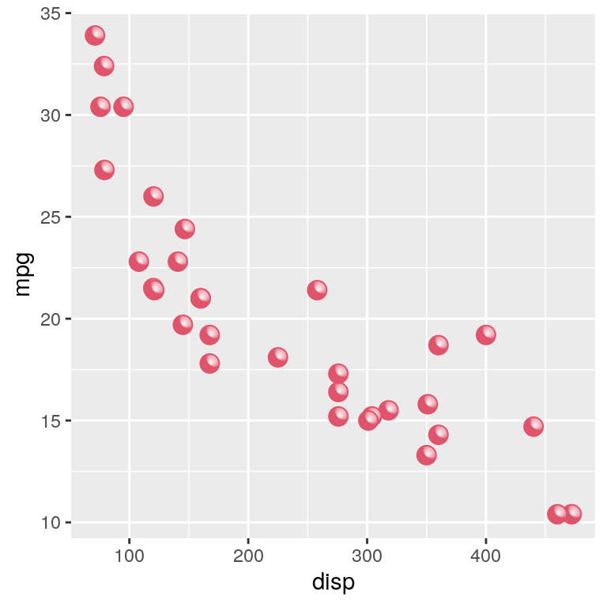

```{r eval=FALSE, echo=FALSE}
knitr::opts_chunk$set(
  fig.width = 4, fig.height = 2
)
```

Support for pattern fills
was added to the R graphics engine 
[in R version 4.1.0](https://blog.r-project.org/2020/07/15/new-features-in-the-r-graphics-engine/), with an R interface via the
'grid' package.

```{r eval=FALSE}
library("grid")
```

For example, the following code defines a linear gradient 
that varies horizontally from red to white and 
a tiling pattern that is based on a repeating red circle.

```{r eval=FALSE}
gradcol <- c(palette()[2], "white")
grad <- linearGradient(gradcol, y1=.5, y2=.5)
patcol <- 2
pat <- pattern(circleGrob(r=unit(2, "mm"), gp=gpar(col=patcol, fill=patcol)),
               width=unit(5, "mm"), height=unit(5, "mm"),
               extend="repeat")
```

The next code calls `grid.rect()` twice, once to fill a 
rectangle with the linear gradient and a second time to fill
another rectangle with the tiling pattern.

```{r eval=FALSE, patterns}
grid.rect(1/3, width=1/4, height=1/2,
          gp=gpar(fill=grad))
grid.rect(2/3, width=1/4, height=1/2,
          gp=gpar(fill=pat))
```

{width=384}

The following code draws the two rectangles with a single call 
to `grid.rect()` and fills them both using the linear gradient.
The result is that both rectangles are filled with the same
gradient from red to white, with the gradient relative to
a bounding box around *both* rectangles (we start with red at
the left edge of the rectangle on the left and end with white at the
right edge of the rectangle on the right).

```{r eval=FALSE, grouppattern}
grid.rect(1:2/3, width=1/4, height=1/2,
          gp=gpar(fill=grad))
```

{width=384}

From R 4.2.0, we can produce a different result because the
`linearGradient()` function has gained a `group` argument.
If we set this to `FALSE`, then we can fill both rectangles
with the "same" gradient fill, but the gradient fill is relative
to individual rectangles, as shown below.

```{r eval=FALSE}
grad2 <- linearGradient(gradcol, y1=.5, y2=.5, 
                        group=FALSE)
```

```{r eval=FALSE, shapepattern}
grid.rect(1:2/3, width=1/4, height=1/2,
          gp=gpar(fill=grad2))
```

{width=384}

Another change in R 4.2.0 is that we can specify more than one pattern fill.
For example, the following code draws the two rectangles in a single
`grid.rect()` call and provides a *list* of pattern fills:
the original linear gradient and the tiling pattern.
The result is that the first rectangle is filled with the linear
gradient and the second rectangle is filled with the tiling pattern.

```{r eval=FALSE, patternlist}
grid.rect(1:2/3, width=1/4, height=1/2,
          gp=gpar(fill=list(grad, pat)))
```

{width=384}

The result is different from the very first example because 
both the linear gradient and the tiling pattern are relative to
a bounding box around both rectangles.  The following code
uses the new `group` argument to fill each rectangle with a different
pattern fill *and* have the pattern fills relative to the individual
rectangles.

```{r eval=FALSE}
pat2 <- pattern(circleGrob(r=unit(2, "mm"), gp=gpar(col=patcol, fill=patcol)),
                width=unit(5, "mm"), height=unit(5, "mm"),
                extend="repeat",
                group=FALSE)
```

```{r eval=FALSE, shapelist}
grid.rect(1:2/3, width=1/4, height=1/2,
          gp=gpar(fill=list(grad2, pat2)))
```

{width=384}

A further addition in R 4.2.0 is the ability to use pattern fills 
on "points" (data symbols).  Combining that with pattern lists
and `group=FALSE`, we can, for example, 
apply pattern fills to individual points on a scatterplot,
as shown below.  For this example, 
the pattern fill is a *radial* gradient from white to red.  

```{r eval=FALSE, ggplot, fig.width=4, fig.height=4}
library("gggrid")
grad3 <- radialGradient(rev(gradcol),
                        cx2=.8, cy2=.8, group=FALSE)
filledPoints <- function(data, coords) {
    pointsGrob(coords$x, coords$y, pch=21,
               gp=gpar(col=patcol, fill=grad3))
}
ggplot(mtcars) +
    grid_panel(filledPoints, 
               mapping=aes(x=disp, y=mpg))
```

{width=384}

Further discussion and more detail about these new facilities
can be found in the
technical report
["Vectorised Pattern Fills in R Graphics"](https://stattech.blogs.auckland.ac.nz/2022/06/01/2022-01).  The technical report 
["Constructive Geometry for Complex Grobs"](https://stattech.blogs.auckland.ac.nz/2022/06/01/2022-02-constructive-geometry-for-complex-grobs)
describes related changes to the `grobCoords()` function that is
used in the resolution of pattern fills.
