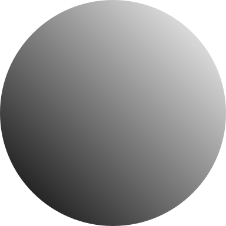
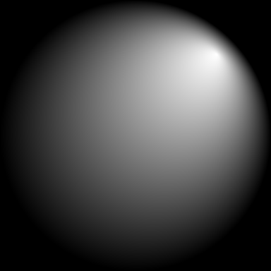
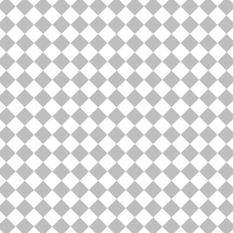
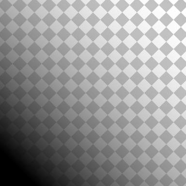
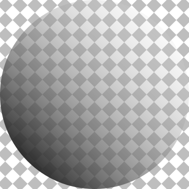

```{r eval=FALSE, echo=FALSE}
knitr::opts_chunk$set(
  fig.width = 2, fig.height = 2
)
```

Support for gradient fills, pattern fills, clipping paths and masks
has been added to the R graphics engine (in the development version
of R, which will probably become R version 4.1.0).

An R-level interface for these new features has been added to the
'grid' graphics package.  

```{r}
library("grid")
```

For example, the following code 
fills a circle with a linear gradient.

```{r eval=FALSE, gradient}
grid.circle(gp=gpar(col=NA, fill=linearGradient()))
```

{width=192}

The next code fills a rectangle with a radial gradient.

```{r eval=FALSE, radial}
grid.rect(gp=gpar(fill=radialGradient(c("white", "black"),
                                      cx1=.8, cy1=.8, r1=0)))
```

{width=192}

The next code fills a rectangle with a pattern of grey diamonds
(by repeating a single grey diamond drawn in the centre of the image).

```{r eval=FALSE, pattern}
pat <- pattern(polygonGrob(unit(.5, "npc") + unit(c(-2, 0, 2, 0), "mm"),
                           unit(.5, "npc") + unit(c(0, 2, 0, -2), "mm"),
                           gp=gpar(col=NA, fill="grey")),
               width=unit(4, "mm"), height=unit(4, "mm"),
               extend="repeat")
grid.rect(gp=gpar(col=NA, fill=pat))
```

{width=192}

The following code applies a mask to the circle with a linear gradient
fill.  First we show the mask itself, which is a rectangle filled with
a linear gradient from black to transparent (drawn over the grey diamond
fill to show the transparency).

```{r eval=FALSE, mask}
mask <- rectGrob(gp=gpar(col=NA,
                         fill=linearGradient(c("black", "transparent"),
                                             x1=.1, y1=.1)))
grid.rect(gp=gpar(col=NA, fill=pat))
grid.draw(mask)
```

{width=192}

Now we apply the mask to the circle with a linear gradient fill, by
pushing a viewport with 
the mask as part of the viewport definition.  Again, we draw
over the top of the diamond fill to show how the semitransparency 
of the mask dictates the semitransparency of the circle.

```{r eval=FALSE, masked}
grid.rect(gp=gpar(col=NA, fill=pat))
pushViewport(viewport(mask=mask))
grid.circle(gp=gpar(col=NA, fill=linearGradient()))
popViewport()
```

{width=192}

Finally, the next code shows a clipping path.
We define a circular clipping path by specifying a grob as the 
`clip` argument for a viewport, then we draw the previous image,
which gets clipped to the circular clipping path.

```{r eval=FALSE, clipped}
pushViewport(viewport(clip=circleGrob()))
grid.rect(gp=gpar(col=NA, fill=pat))
pushViewport(viewport(mask=mask))
grid.circle(gp=gpar(col=NA, fill=linearGradient()))
popViewport()
```

{width=192}

What use are these new features?  That's where you come in!
Let us know what use you can make of these new features
and how the current implementation helps or hinders with that.
Further discussion and more detail about the new features and
how they have been implemented can be found in
<a href="https://stattech.blogs.auckland.ac.nz/2020/07/14/2020-04-catching-up-with-r-graphics/">this technical report</a>.

The new features have only been implemented on a subset of graphics 
devices so far: `cairo_pdf()`, `cairo_ps()`,
`x11(type="cairo")`, `png(type="cairo")`,
`jpeg(type="cairo")`, `tiff(type="cairo")`, `svg()`, and `pdf()`.
Although there is no support yet for `quartz()` or `windows()`,
almost all of the graphics devices above will work on all major platforms.

R packages that implement graphics devices will need to be updated and 
reinstalled just so that they do not crash R, even if they do not
yet offer any support for the new features.

This work was partially funded by a donation from R Studio to the
University of Auckland Foundation.
