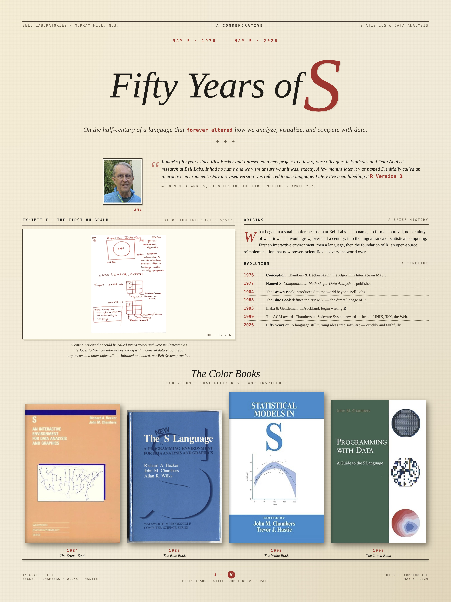

Today marks 50 years since Rick Becker and John Chambers presented a new project to a few of their colleagues in Statistics and Data Analysis research at Bell Labs. John writes:

> It had no name and we were unsure what it was, exactly.  A few months later it was named S, initially called an interactive environment.  Only a revised version was referred to as a language.  (Lately I’ve been labelling it R Version 0.)

A poster by Balasubramanian Narasimhan summarizes 50 years of S and R. You can [download](s_at_50_poster.jpg) the full size poster or open up the image below in a new tab to see it full size.

